# Board and map topologies in existing games

A survey of how published tabletop games structure their maps: **shape, topology and mechanics**, not art style. It is meant as input for deciding which kinds of boards Protogames should be able to draw.

The pictures are our own schematics (`docs/board-topologies/*.svg`), not the publishers' board art: they show only what matters for how the map works (cells, links, regions, tracks). Details can differ between editions and expansions.

**How to read the last column.** "Protogames" says how close the current editor gets: **yes** (a board shape and grid we already draw), **partly** (the playing surface can be drawn but a rule or link cannot), **no** (needs a different kind of map).

## The families at a glance

| Family | What a position is | Movement and adjacency | Games below |
|---|---|---|---|
| Cell grid | a cell (square, hex or triangle) | neighbours by edge, sometimes by corner | Chess, Battleship, Santorini, Catan (tiles), Terra Mystica, Spirit Island |
| Intersection grid | a point where lines cross | along the lines | Go |
| Modular tiles | a tile placed during play | the map is built as you go, edges must match | Carcassonne, Eclipse, Gloomhaven |
| Free-form | the pieces themselves | contact between pieces | Hive |
| Areas (regions) | an irregular region | shared borders, sea links, special links | Risk, Diplomacy, Small World |
| Network (point to point) | a node (city, clearing) | links with a length, type or cost | Ticket to Ride, Brass, Root, Clue |
| Track / loop | a space on a path | one direction, or two, along the path | Monopoly, Snakes and Ladders, Ludo, Backgammon, Mancala |
| Personal board | a slot on a private board | none shared | Agricola |

## Table

| Game | Map (schematic) | Topology | How the map works | Protogames |
|---|---|---|---|---|
| **Chess** | 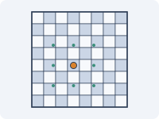 | Square cell grid, 8 x 8, alternating colours | Pieces occupy cells and move along rows, columns and diagonals; the geometry is what defines each piece (rook, bishop, knight jumps). | yes (square grid, rectangle board) |
| **Go** | 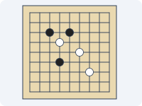 | Intersection grid, 19 x 19 (also 13 x 13, 9 x 9) | Stones go on the line crossings, not in the squares. Four neighbours per point; groups of connected stones are captured when they run out of empty neighbouring points ("liberties"). | no (cells, not crossings) |
| **Battleship** |  | Two hidden square grids with coordinates | Each player's fleet is on a private grid; shots are called by coordinate, so the map is also a lookup key (A3). | partly (the grid yes, hidden state no) |
| **Santorini** |  | Square grid, 5 x 5, with a height per cell | Builders move and build on neighbouring cells, stacking levels up to a dome. Height is part of the map: you can climb one level at a time. | partly (flat grid yes, levels no) |
| **Catan** | 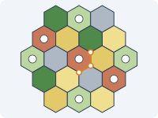 | Modular hex tiles, with play on the **corners and edges** | Hexes are shuffled at setup and produce a resource when their number is rolled. Settlements sit on tile corners (touching up to three hexes) and roads on tile edges, so the playable graph is the vertices and edges of the hex grid. | partly (hex board yes, corner and edge slots no) |
| **Terra Mystica** | 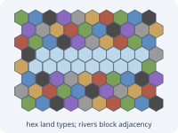 | Fixed hex grid with seven land types and rivers | Each faction has one home terrain; building on other terrain costs spades. Rivers split the board, and reaching across them (shipping) is what makes buildings "adjacent". | yes (hex board with palette), river rules no |
| **Spirit Island** | 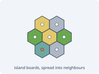 | Small modular hex island boards, one land type per hex | Boards are joined at the edges to make an island; invaders spread to neighbouring lands of certain types and the sea ring around it. Number of boards scales with players. | partly |
| **Hive** |  | Free-form: no board at all | The hexagonal pieces are the map. A piece must stay in contact with the hive, and movement is sliding around the outside, so the "board" is whatever has been laid. | partly (the infinite canvas is the closest thing) |
| **Twilight Imperium** | 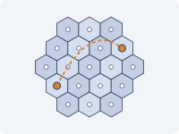 | Hex map of systems, with **non-adjacent links** | Each hex is a system (planets, anomalies, empty space) and ships move a number of hexes. Wormholes join distant systems as if adjacent, so adjacency is hex adjacency plus extra links. | partly (hex map yes, wormholes no) |
| **Eclipse** | 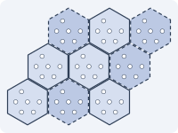 | Galaxy built from large hex sectors that are drawn and placed | Sectors are revealed as you explore; each has planet slots and wormhole edges that have to line up with neighbours, so the map grows during play. | no (map built during play) |
| **Gloomhaven** | 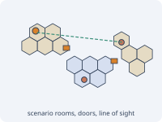 | Scenario maps assembled from hex room tiles, with doors | Each scenario defines which tiles go where. Hexes carry terrain, traps and obstacles; doors open new rooms; **line of sight** between hexes matters for ranged attacks. | partly (hex rooms yes, doors and sight no) |
| **Carcassonne** | 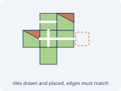 | Modular square tiles, laid on an unbounded grid | A tile is drawn and placed so that its edges (road, city, field) match its neighbours; the finished features score. The map is the record of the game. | no |
| **Risk** | 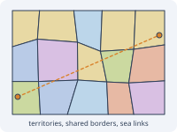 | Area map: irregular regions grouped into continents, plus sea links | A territory touches those that share a border, and a few printed links cross oceans. Armies attack neighbours; holding a whole continent gives a bonus. | partly (a country board can draw outlines, not link rules) |
| **Diplomacy** | 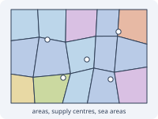 | Area map of land provinces, coasts and sea areas | Units sit in provinces (one per province), move to adjacent ones, and support or convoy. Supply-centre provinces decide who can build. | partly |
| **Small World** | 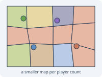 | Area map, **one board per player count** | A deliberately crowded map: fewer regions for fewer players. Region types (forest, hill, swamp) and borders decide where you can conquer. | partly |
| **Ticket to Ride** |  | Network of cities joined by routes of a given length and colour | Players claim a route by playing as many cards of its colour as it has segments; the points come from joining specific cities. Parallel routes exist for bigger player counts. | no |
| **Brass** |  | Network of towns with canal links, later rail links | Industries are built on slots in towns; links must be built to connect markets and resources. In the second era canals are removed and rails take their place, so the graph changes mid-game. | no |
| **Root** |  | Network of clearings with a limited number of slots each, with forest between | Clearings are the places, with paths between them and rivers as extra paths for boats. Each clearing has building slots, and control of a clearing goes to whoever has the most pieces there. | no |
| **Clue (Cluedo)** |  | Rooms linked by a hallway grid and secret passages | Movement is dice-driven along hallway squares to enter rooms; corner rooms are joined diagonally by secret passages. The map doubles as the set of possible answers. | partly |
| **Monopoly** | 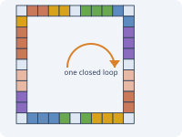 | Closed loop of 40 spaces | One direction, dice-driven; the space you land on carries the rule. Properties are grouped by colour into sets. | partly (a loop of square cells) |
| **Snakes and Ladders** | 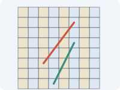 | Linear track laid out as a boustrophedon grid, with shortcuts | The numbered track winds back and forth across the grid; ladders and snakes are one-way links to other numbers, so the grid layout is only a way of drawing a line. | yes (square grid), links no |
| **Ludo / Parcheesi** |  | Cross-shaped loop with a private home column per colour | All pieces share one circuit, then peel off into their own safe home column; bases at the corners hold pieces waiting to enter. | partly |
| **Backgammon** |  | Linear track of 24 points, bent into a horseshoe, travelled in opposite directions | Both players move through the same points in opposite directions, so a point is held by stacking checkers and a lone checker can be hit. | no |
| **Mancala** | 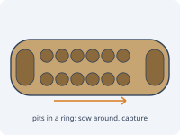 | Ring of pits with a store at each end | "Sowing": lift all the stones from a pit and drop one into each following pit, wrapping around; landing places can capture. The map is a counter ring. | no |
| **Agricola** | 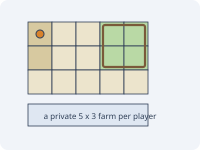 | Personal 5 x 3 grid per player | Nothing is shared: each player's farm is a small grid where rooms, fields and fenced pastures are placed, and adjacency inside the farm matters for fences. | partly (a 5 x 3 rectangle yes) |

## What stands out for Protogames

These are observations from the table, not decisions.

- **Cell grids are the common core.** Square, hex and triangle cells under a rectangle, hexagon, triangle or circle outline cover Chess, Terra Mystica, Spirit Island, Gloomhaven rooms, Santorini and Agricola, which is about a quarter of the list.
- **The cell is not always where the game happens.** Catan plays on corners and edges, Go on crossings. A board could expose "corners" and "edges" as optional places to put pieces without changing the tiles.
- **Many maps need extra links on top of adjacency**: wormholes, sea lanes, secret passages, ladders, doors. A way to draw a named link between two places would unlock a lot of games.
- **Region and network maps are a different model**: irregular areas with borders (Risk, Diplomacy, Small World) and nodes with edges (Ticket to Ride, Brass, Root). The country board is the first step towards areas; nothing yet covers networks.
- **Maps that are built or change during play** (Carcassonne, Eclipse, Hive, Brass) suggest tile sets and a "place a tile" mode rather than a fixed board.
- **Tracks and loops** (Monopoly, Ludo, Backgammon, Mancala) are paths rather than areas; a path-shaped board with numbered or typed spaces would cover them.
