# Board and map topologies in existing games

A survey of how published tabletop games structure their maps: **shape, topology and mechanics**, not art style. It is meant as input for deciding which kinds of boards Protogames should be able to draw, and how hard each would be to add.

For every game the survey shows

- a **photo of the real board** (hotlinked from Wikimedia Commons, see [Image credits](#image-credits); nothing is copied into this repository),
- our own **schematic** (`*.svg` in this folder) that keeps only what matters for how the map works (cells, links, regions, tracks),
- the **topology and how the map works**, checked against the game's **rulebook** (linked, with the page or section that describes the board),
- how much Protogames **already covers** and how hard the rest would be to **add**.

The descriptions were written from memory first and then checked against the rulebooks. The check corrected several rows (Spirit Island was wrong, Eclipse, Diplomacy, Root, Brass, Ticket to Ride, Clue and others were imprecise). Where a rulebook does not say something we kept in the table, the text says so. Editions differ; the edition checked is named in the rulebook column.

> **Status: research survey, not a plan or a specification.** Facts about other games were checked against rulebooks; the difficulty estimates are a developer's guess. Links and images last checked: 2026-10-26 (see the end of [Image credits](#image-credits) for the sources that block automated checks). For what Protogames can draw today, the authority is [../../SPECIFICATION.md](../../SPECIFICATION.md), not the "Covered today" column.

**How to read this.** Start with [The families at a glance](#the-families-at-a-glance) to see the eight kinds of map. Then look up a game in [The games](#the-games) (photo, schematic, topology, rulebook). Then go to [How much Protogames covers](#how-much-protogames-covers-and-what-it-would-take) for that game's gap and size, and to [Building blocks](#building-blocks-and-which-games-they-unlock) to see which missing features are shared between games. [What stands out](#what-stands-out-for-protogames) is the short conclusion.

**Contents**

1. [How to read the estimates](#how-to-read-the-estimates)
2. [The families at a glance](#the-families-at-a-glance)
3. [The games](#the-games) (25 games, one row each, each with a schematic in this folder)
4. [How much Protogames covers, and what it would take](#how-much-protogames-covers-and-what-it-would-take)
5. [Building blocks, and which games they unlock](#building-blocks-and-which-games-they-unlock)
6. [What stands out for Protogames](#what-stands-out-for-protogames)
7. [Image credits](#image-credits)

## How to read the estimates

**Covered today** compares the game's map with what the editor draws now: square, hexagon and triangle tiles on rectangle, hexagon, triangle, circle, infinite and country boards, a colour palette, one placeable object per tile, start markers, and playtest with pieces and dice.

**Difficulty** is a rough guess for one developer who knows this codebase, for the *missing* part only. It covers the editor, saving (a format version bump with migration, fixture, tests and spec, as the project requires), share links and print, but **not** rules enforcement.

| Size | Meaning |
|---|---|
| **S** | A few days. Presets, labels or a render mode; usually no change to the saved format. |
| **M** | One to two weeks. New per-tile data or a new tool, which needs a format version bump. |
| **L** | Several weeks. A new kind of board or editor (new data model, tools, drawing, print, share). |
| **XL** | Months, or a separate subsystem such as a rules engine. Mostly out of scope for a map editor. |

## The families at a glance

| Family | What a position is | Movement and adjacency | Games |
|---|---|---|---|
| Cell grid | a cell (square or hex) | neighbours by edge, sometimes by corner | Chess, Battleship, Santorini, Catan (tiles), Terra Mystica, Clue |
| Intersection grid | a point where lines cross | along the lines | Go |
| Modular tiles | a tile placed during play | the map is built as you go | Carcassonne, Eclipse, Gloomhaven |
| Free-form | the pieces themselves | contact between pieces | Hive |
| Areas (regions) | an irregular region | shared borders, special links | Risk, Diplomacy, Small World, Spirit Island |
| Network (point to point) | a node (city, clearing) | links with a length, type or cost | Ticket to Ride, Brass, Root |
| Track / loop | a space on a path | one direction, or two, along the path | Monopoly, Snakes and Ladders, Parcheesi, Backgammon, Mancala |
| Personal board | a slot on a private board | none shared | Agricola |

## The games

Rulebook references give the edition checked and where the board or its movement rules are described. "Not stated" means the rulebook text we read does not say it.

| Game | Real board | Schematic | Topology and how the map works | Rulebook |
|---|---|---|---|---|
| **Chess** |  |  | **Square cell grid, 8 x 8, alternating light and dark.** Pieces occupy squares and move along files, ranks and diagonals; the knight jumps to the nearest square off its own line. The geometry is what defines each piece. | [FIDE Laws of Chess, 2023](https://handbook.fide.com/chapter/E012023): Art. 2.1 (board), 3.2 to 3.8 (movement) |
| **Go** |  (close-up) |  | **Intersection grid, 19 x 19** (13 x 13 and 9 x 9 are the common smaller sizes). Stones go on the line crossings, not in the squares. Strings connect horizontally and vertically only (four neighbours); the empty neighbouring points are "liberties", and a string with none is captured. Self-capture is illegal. | [Official AGA Rules of Go, 1991](https://www.cs.cmu.edu/~wjh/go/rules/AGA.html): Rules 1, 2 and 5 |
| **Battleship** |  | 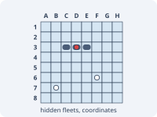 | **Two hidden grids per player, with coordinates.** Each player has an ocean grid for their fleet (ships horizontal or vertical only) and a target grid for their shots; shots are called by letter and number (D-4), so the map is also a lookup key. The grid size is not stated in the rulebook. | [Hasbro Battleship, item A3264, 2016](https://assets-us-01.kc-usercontent.com:443/500e0a65-283d-00ef-33b2-7f1f20488fe2/e60576f0-416a-4c1e-a250-65e421687c89/A32643480_Battleship_INST_RC_FAR.pdf): p. 1, "Prepare for battle" and "Take your shot" |
| **Santorini** |  | 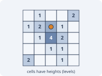 | **Square grid, 5 x 5 (the rulebook implies it with 16 perimeter spaces), with a height per cell.** A builder moves to any of up to eight neighbouring spaces (diagonals included), climbing at most one level up (dropping any number), then builds a block or dome on a neighbouring space. Domes cap level-3 towers; stepping up onto level 3 wins. | [Roxley rulebook, 2017](https://cdn.shopify.com/s/files/1/0246/2190/8043/files/Santorini_-_Rulebook_-_Print_-_2017.02.05_WEB.pdf): p. 1 (Move, Build), p. 6 (glossary) |
| **Catan** |  |  | **Modular hex tiles, with play on the corners and edges.** 19 terrain hexes form a variable island. Settlements and cities go on hex corners (where up to three hexes meet) and roads on hex edges, so the playable graph is the vertices and edges of the hex grid. | [Catan Game Rules and Almanac, 2020](https://www.catan.com/sites/default/files/2021-06/catan_base_rules_2020_200707.pdf): p. 2 (island), p. 4 (corners and edges), Almanac p. 8 |
| **Terra Mystica** |  |  | **Fixed hex grid with seven terrain types and rivers.** Each faction has a home terrain; other terrain must be transformed with spades. Hexes sharing an edge are directly adjacent; a river can be crossed by a bridge (direct) or by shipping (indirect adjacency), which decides where you may build. | [Z-Man rules](https://images-cdn.zmangames.com/us-east-1/filer_public/3c/b1/3cb1119d-85cb-4905-bfe6-d428a3024e1b/zm7240_terra_mystica_rules.pdf): p. 3 (setup), 9 to 11 (building, transforming, adjacency), 17 (bridges). The host's certificate has expired, so the browser may warn. |
| **Clue (Cluedo)** |  | 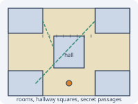 | **Rooms joined by a square-grid hallway, with secret passages.** Pawns roll dice and move square by square, horizontally or vertically (never diagonally), enter a room through a door and stop on entry. The rooms in opposite corners are joined by secret passages, usable instead of rolling. Rooms also double as the possible answers (from memory, not checked in the rules). | [Hasbro Clue, 2002](https://assets-us-01.kc-usercontent.com:443/500e0a65-283d-00ef-33b2-7f1f20488fe2/519db278-917d-41d4-b0f9-23e255d32245/5c28906c0ce2d9e999519282487723f5.pdf): p. 2, "Moving Your Character Pawn" |
| **Go-style and track games** | | | See the track and loop rows further down. | |
| **Carcassonne** |  |  | **Modular square tiles laid edge to edge.** A starting tile is placed; each turn a player draws a tile and places it next to the existing tiles so that the landscape (road, city, field) matches along touching edges, then may place a meeple and scores completed features. The rules never mention a grid or a limit ("unbounded" is our inference). | [Hans im Glück rulesheet v3](https://www.hans-im-glueck.de/wp-content/uploads/2024/11/Carcassonne-v3_Rulesheet_EN_web.pdf): p. 2 (setup), 3 to 4 (placing a tile, cities, monasteries) |
| **Eclipse** |  |  | **A galaxy of hex sector tiles built during play.** Sectors go into predefined zones in three rings around the galactic centre; each is drawn from its ring's stack when a player explores an empty zone next to a sector where they have control or an unpinned ship. It may be placed so that a wormhole connection is made with the exploring sector, or it is discarded. Ships move only across wormhole connections. | [Eclipse: Second Dawn rulebook, 2020](https://cdn.1j1ju.com/medias/bb/af/07-eclipse-second-dawn-for-the-galaxy-rulebook.pdf) (a mirror; publisher page: [Lautapelit.fi](https://www.lautapelit.fi/Eclipse_-_2nd_Dawn_for_the_Galaxy_ENG)): p. 7 (zones, rings, wormholes), p. 9 (explore) |
| **Gloomhaven** | no free photo, see [publisher page](https://cephalofair.com/products/gloomhaven-board-game-2nd-edition) |  | **Scenario maps assembled from hex map tiles.** Each scenario entry shows which tiles to lay out. Walls enclose rooms and hexes across a wall line are not adjacent; overlay tiles add traps, obstacles and terrain; doors open to further rooms. Ranged targeting needs line of sight, which walls and closed doors block. | [Gloomhaven rulebook, 2025](https://drive.google.com/file/d/16TmmCKa6zVVObj2qM-vIj9RcEAC3nfMT/view?usp=sharing) (linked from [Cephalofair](https://cephalofair.com/pages/gloomhaven)): p. 10 to 13 (map tiles, walls, overlays), p. 19 (line of sight) |
| **Hive** |  | 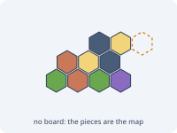 | **Free-form: no board at all.** The hexagonal pieces in play define the playing surface. Every piece must stay touching another and the hive must stay connected. Most creatures slide around the outside; the grasshopper jumps and the beetle climbs on top. | [Gen42 Hive rules](https://www.gen42.com/wp-content/uploads/Hive-rules.pdf): p. 2 (placing), 3 (the hive, moving), 10 (freedom to move) |
| **Risk** |  |  | **Area map: 42 territories in 6 continents.** A territory may attack any territory touching it or joined to it by a printed dashed line (Greenland to Iceland, Alaska to Kamchatka across the board edge). Controlling a whole continent earns bonus armies. | [Hasbro Risk instructions (rules 1993)](https://www.hasbro.com/common/instruct/Risk.PDF): PDF p. 3 (board), 6 (continents), 8 (attack) |
| **Diplomacy** |  (a digital render, not a photo) |  | **Area map of land, coastal and sea provinces, with 34 supply centres.** Only one unit per province; armies move on land and coasts, fleets on water and coasts, to adjacent provinces; armies cross water by fleet convoy and some provinces have two coasts. Each supply centre you hold earns one unit, built only on your own vacant home supply centres. | [The Rules of Diplomacy, 2008](https://media.wizards.com/2015/rules/diplomacy_rules.pdf) (about 30 MB): p. 4 (board), 5 (units), 7 and 13 (movement, convoys), 18 to 19 (builds) |
| **Small World** |  | 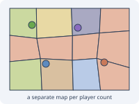 | **Area map with a separate map for each player count** (2 to 5; the turn track also differs by map). A conquest must be a region sharing a border with one you hold, unless a power says otherwise; it costs 2 tokens plus 1 per mountain, fortress, encampment, troll lair, lost tribe or enemy token. The first entry is through a border region. Seas and lakes cannot normally be conquered. | [Days of Wonder rules, 2018](https://cdn.svc.asmodee.net/production-daysofwonder/uploads/2024/07/7901-SW-rules-EN-2018_lowres.pdf): p. 1 (components), 2 (setup), 3 (conquering) |
| **Spirit Island** |  | 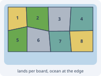 | **Modular island boards made of irregular lands (not a hex grid).** One board per player; each is divided into 8 numbered lands, two each of jungle, mountain, sands and wetland. Lands that touch are adjacent, even at a corner or across boards. A board also shows an ocean edge; lands touching it are coastal. Invaders explore into lands of the drawn type that are next to a town, city or ocean. | [Greater Than Games core rulebook](https://shop.greaterthangames.com/products/spirit-island) (download link on the product page): p. 4 (modular boards), 6 (setup), 10 (explore), 13 (boards and lands) |
| **Twilight Imperium** |  (third edition photo) |  | **Map of system tiles (hexes), with non-adjacent links.** Each tile is a system (planets, anomalies, empty space). Two systems are adjacent when their tile sides touch; systems with matching wormholes also count as adjacent. Ships move up to their move value along a path of adjacent systems. | [Learn to Play, 4th ed.](https://cdn.svc.asmodee.net/production-fantasyflightgames/uploads/2026/08/ti-k0289_learn_to_play_2020_web.pdf): p. 13 to 14; [Living Rules Reference v2.0](https://cdn.svc.asmodee.net/production-fantasyflightgames/uploads/2026/08/ti10_pok_living_rules_reference_20_web.pdf): rule 6, Adjacency |
| **Ticket to Ride** |  (close-up) | 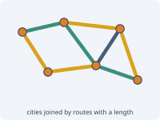 | **Network of cities joined by routes of a given length and colour.** A route is claimed by playing a set of same-colour cards equal to its length (gray routes take any one colour, locomotives are wild). Points come from the routes claimed (1, 2, 4, 7, 10, 15 for lengths 1 to 6), completed destination tickets and the longest path. Some city pairs have double routes; in 2 to 3 player games only one of the two may be used. | [Days of Wonder rules (USA), 2015](https://ncdn0.daysofwonder.com/tickettoride/en/img/tt_rules_2015_en.pdf): p. 2 to 3 (claiming routes, scoring) |
| **Brass: Birmingham** |  | 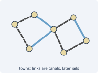 | **Network of locations with industry slots and printed link lines.** Industries are built on slots in locations; links go on the printed lines between locations, canal links only in the canal era and rail links only in the rail era. A network is needed to sell and to consume coal. At the end of the canal era all links and all level-1 industries are removed, so the network resets for the rail era. | [Roxley rulebook v2018.11](https://cdn.shopify.com/s/files/1/0246/2190/8043/files/Brass-Birmingham-Rulebook.pdf?v=1758826281): p. 3 (setup), 4 (eras), 5 to 6 (build, network) |
| **Root** |  | 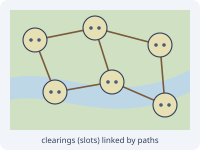 | **Network of clearings linked by paths, with forest between.** A clearing is adjacent to those linked to it by a path. Each clearing has a suit and a number of building slots. Rivers also link clearings but are not paths unless an effect says so. A player rules a clearing with strictly more warriors plus buildings there than each other player (a tie means nobody rules it). | [Law of Root, Oct 2025](https://cdn.shopify.com/s/files/1/0106/0162/7706/files/Root_Base_Law_Oct_2025.pdf?v=1774903758): section 2.2 (clearings, paths, slots), 2.3 (rivers), 2.4 (forests), 2.5 (rule) |
| **Monopoly** |  (German edition) |  | **One loop around the board.** Tokens move in one direction by the dice; the space you land on carries the rule (buy, rent, tax, card, jail), and passing GO pays a salary. Properties are grouped into colour sets. The standard board has 40 spaces, which the rulebook text we read does not state. | [Hasbro Monopoly rules](https://www.hasbro.com/common/instruct/monopoly.pdf) (scanned, 1994 wording): p. 1 (equipment), 2 (the play, GO), 3 (properties, colour groups) |
| **Snakes and Ladders** |  |  | **A numbered track from 1 to 100 drawn as a back-and-forth grid.** Players move by the spinner or die; ladders carry a pawn up to a higher square and snakes (chutes) carry it down. The back-and-forth layout is only a way of drawing a line (shown on a picture-only page of the rulebook). | [Hasbro Chutes and Ladders playbook, 2015](https://instructions.hasbro.com/api/download/A4756_en-ca_chutes-and-ladders-game.pdf): p. 6 to 12. A toy playbook, not a full rules document. |
| **Parcheesi (Ludo)** |  (vintage Parcheesi) | 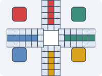 | **A cross-shaped circuit with a private home path per colour.** All pawns share one counterclockwise circuit, enter it from a start circle on a roll of five, then leave it onto their own home path leading to the central home square. Ludo (UK) is a related game whose rules were not checked. | [Hasbro Parcheesi rules, 2001](https://www.hasbro.com/common/instruct/Parcheesi_%282001%29.pdf) (scanned): p. 1 (setup, entering, moving) |
| **Backgammon** |  | 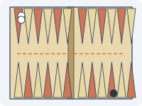 | **A track of 24 triangular points in four quadrants of six, split by the bar.** Each player numbers the points from their own home board; checkers move forward, to lower-numbered points, in opposite directions. (A blocked point and hitting a lone checker are standard rules but were not verified in the page read.) | [USBGF Rules of Backgammon](https://www.usbgf.org/learn-backgammon/backgammon-rules-and-terms/rules-of-backgammon/): board description near the top, Figure 2 |
| **Mancala (Kalah)** |  (a small board with three pits per side) | 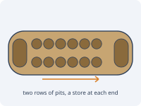 | **Two rows of six pits with a store at each end, forming a counterclockwise loop.** A player lifts all the seeds from a pit and sows one in each following pit, including their own store but skipping the opponent's. A last seed in the own store gives another turn; a last seed in an empty own pit captures the opposite pit. Rules vary between mancala games; this is Kalah. | No publisher rulebook found. [Champion's patent US 2,720,362](https://patents.google.com/patent/US2720362A/en) (1955; it describes 3 seeds per pit, modern rules use 4); [Wikipedia: Kalah](https://en.wikipedia.org/wiki/Kalah) |
| **Agricola** |  |  | **A personal grid per player.** Nothing is shared: each farmyard is a small grid of spaces (5 x 3, seen on the board) holding rooms, fields, pastures and stables. New rooms, fields and pastures must be adjacent to existing ones of the same kind, and pastures are made by fencing spaces completely. | [Lookout rules, Revised Edition 2016](https://lookout-spiele.de/upload/en_agricolare.html_Rules_Agricola-RE_EN.pdf): p. 2 (setup), 4 (adjacency), 7 to 8 (rooms, fences, fields) |

## How much Protogames covers, and what it would take

"Covered today" is a judgement against the current editor (see [How to read the estimates](#how-to-read-the-estimates)). The difficulty is for the part that is missing.

**Where this meets the roadmap** (GitHub issues, all open; the overall plan is [#52](https://github.com/bremondr/protogames/issues/52)): a custom board shape, which would give the hollow and masked shapes below, is [#11](https://github.com/bremondr/protogames/issues/11); roads, rails, paths and rivers are [#13](https://github.com/bremondr/protogames/issues/13), highlighted borders between tiles are [#15](https://github.com/bremondr/protogames/issues/15), and both would sit on the edge and vertex data model [#43](https://github.com/bremondr/protogames/issues/43), which is the "edge features" and "vertex and edge places" building blocks. Text or notes on a tile (coordinates, labels) is [#12](https://github.com/bremondr/protogames/issues/12), and per-tile data (levels, counters) is close to [#41](https://github.com/bremondr/protogames/issues/41). There is no issue yet for region maps, network maps, tile-set mode or several boards in one project. What exists today is in [../../SPECIFICATION.md](../../SPECIFICATION.md).

| Game | Covered today | What is missing | Difficulty |
|---|---|---|---|
| Chess | **Full.** An 8 x 8 rectangle of square tiles; two-tone squares by painting. | A checkerboard fill, coordinate labels, a chess piece set. | **S** (labels, preset); custom piece art **M** |
| Go | **Most.** A 19 x 19 square board with stones as disc pieces. | Drawing the lines through tile centres, star points (intersection render mode). | **S** |
| Battleship | **Most for the map.** A 10 x 10 square grid, pegs as objects. | Coordinate labels (**S**); two hidden grids per player, hidden information (**L**). | **S** map, **L** with hidden play |
| Santorini | **Partly.** The 5 x 5 grid and builders. | A height per tile with stacked blocks and domes. | **M** |
| Catan | **Partly.** A radius-2 hex board with terrain colours; number tokens as objects. | Random setup (shuffle terrains and numbers); corner and edge places for settlements and roads. | **S to M** setup; **L** corner and edge places |
| Terra Mystica | **Most.** Hex grid, seven terrains and rivers through a custom palette, structures as objects. | A terrain preset; bridge and shipping adjacency is a rule, not a map feature. | **S** |
| Clue | **Most.** Rooms and hallway squares painted on a square grid. | Doors on room edges and secret passage links. | **M** |
| Carcassonne | **Little.** The square grid exists. | Tiles with typed edges, rotation, a draw pile, matching on placement (tile-set mode). | **L**; scoring **XL** |
| Eclipse | **Little.** Hex grid, but sectors are large tiles with inner slots, built during play. | Sector tiles with sub-slots at a different scale, stacks per ring, wormhole edges. | **L** |
| Gloomhaven | **Partly.** Hex rooms painted on a hex board; obstacles and traps as objects. | Walls and doors on hex edges. Line of sight is a rule. | **M** (walls and doors); line of sight **XL** |
| Hive | **Partly.** An infinite hex canvas exists. | Playing on a blank canvas with the pieces as the map, custom piece kinds, stacking (beetle). | **M** |
| Risk | **Little to partly.** The country board draws real outlines from tiles. | A region model: irregular regions, adjacency, named links, continent groups. | **L** (import vector regions); **XL** (draw regions in the editor) |
| Diplomacy | **Little.** As Risk. | The region model plus province kinds (land, coast, sea) and supply-centre markers. | **L** |
| Small World | **Little.** As Risk. | The region model plus several maps per player count. | **L** |
| Spirit Island | **Little.** Lands could be approximated with hex tiles. | Irregular numbered lands, an ocean edge, joining several boards. | **L** (shares the region model) |
| Twilight Imperium | **Most.** A hex map with planets as objects. | Wormhole links between distant tiles. | **M** (links) |
| Ticket to Ride | **None.** | A network model: nodes, routes with length and colour. | **L** |
| Brass | **None.** | A network with industry slots and era-specific link lines. | **L** |
| Root | **None.** | A network of clearings with slots and river links. | **L** first; **S to M** once the network model exists |
| Monopoly | **Partly.** A rectangle board painted as a ring, the middle left blank. | A hollow (ring) board shape; an ordered, directed track. | **S** (shape); **M** (ordered track) |
| Snakes and Ladders | **Most.** A 10 x 10 square board. | Back-and-forth numbering (**S**); ladders and snakes as links (**M**). | **S** numbering, **M** links |
| Parcheesi (Ludo) | **Most.** A cross-shaped circuit painted on a square board; start markers for bases. | An ordered circuit and safe-space markers. | **S** |
| Backgammon | **Partly.** Triangle tiles exist, but the standard layout is two facing rows of points. | Point tiles in two facing rows and stacked checkers. | **M** |
| Mancala | **Little.** | Round pit tiles with a seed count per tile. | **M** |
| Agricola | **Most.** A 5 x 3 rectangle with painted rooms and fields. | Fences on tile edges; animal counters. | **M** |

## Building blocks, and which games they unlock

Most missing features are shared, so the cost of the second game that needs one is much lower than the first.

| Building block | Games | Difficulty | Notes |
|---|---|---|---|
| Labels, numbers and coordinates on tiles | Chess, Go, Battleship, Snakes and Ladders, Monopoly | **S** | Mostly rendering and print. |
| Presets and generators (checkerboard fill, random terrain and numbers) | Chess, Catan, Terra Mystica | **S to M** | No format change. |
| Intersection render mode (lines through tile centres) | Go | **S** | The centres already are the playable points. |
| Hollow and masked board shapes (ring, cross) | Monopoly, Parcheesi, Clue | **S to M** | A new board shape, or a mask over the rectangle. |
| Per-tile levels (height, stacking) | Santorini | **M** | New per-tile field and shading. |
| Per-tile counters (seeds, animals, stacks of checkers) | Mancala, Agricola, Backgammon | **M** | New per-tile field. |
| Named links between tiles | Twilight Imperium, Snakes and Ladders, Clue, Risk (sea links) | **M** | A list of tile pairs, a tool to draw them, an arc renderer. |
| Ordered tracks | Monopoly, Parcheesi, Backgammon, Snakes and Ladders | **M** | An order and direction over a set of tiles. |
| Edge features (walls, doors, fences, rivers) | Gloomhaven, Agricola, Clue | **M to L** | Needs the tile edges as addressable things. |
| Vertex and edge places | Catan | **L** | Shared corners and edges, drawing, pieces on them, saving, print. |
| Blank-canvas play with custom piece kinds | Hive | **M** | Pieces would become the map. |
| Several boards in one project | Spirit Island, Agricola, Battleship | **M to L** | A big change to the project format. |
| Hidden information per player | Battleship | **L** | A different play model. |
| Tile-set mode (place a tile, rotate, matching edges) | Carcassonne, Eclipse | **L** | Tile definitions, a draw pile, edge types. |
| Region maps (import or draw) | Risk, Diplomacy, Small World, Spirit Island | **L to XL** | Importing a vector map is much cheaper than a drawing editor. |
| Network maps (nodes and routes) | Ticket to Ride, Brass, Root | **L** | A new kind of board, not tile based. |
| Rules enforcement (line of sight, scoring, legal moves) | Gloomhaven, Carcassonne, all | **XL** | Out of scope for a map editor. |

## What stands out for Protogames

These are observations from the survey, not decisions.

- **Cell grids are the common core**, and already well covered: Chess, Go, Terra Mystica, Santorini, Clue, Twilight Imperium, Snakes and Ladders, Parcheesi and Agricola need little beyond labels, presets and a few per-tile fields.
- **Named links between tiles** (wormholes, ladders, secret passages, sea lanes) are the cheapest big win: one **M** feature that helps four games.
- **The cell is not always where the game happens.** Catan plays on corners and edges, Gloomhaven and Agricola on edges (walls, doors, fences). Making edges and corners addressable is an **M to L** investment that several games share.
- **Region and network maps are a different model.** Risk, Diplomacy, Small World and Spirit Island are regions; Ticket to Ride, Brass and Root are networks. The country board is a first step towards regions; nothing covers networks.
- **Maps built or changed during play** (Carcassonne, Eclipse, Hive, Brass) suggest tile sets and a "place a tile" mode rather than a fixed board.
- **Rules are a separate problem.** Line of sight, scoring and legal moves are not map features, and the estimates leave them out.

## Image credits

Photos are hotlinked from Wikimedia Commons and belong to their authors; the licence is shown for each. Credit and licence were taken from the Commons metadata. Click through for the file page.

| Image | Author | Licence | Source |
|---|---|---|---|
| Chess | Lee Daniel Crocker | Public domain | [Commons](https://commons.wikimedia.org/wiki/File:Staunton_chess_set.jpg) |
| Go | Dietmar Rabich | CC BY-SA 4.0 | [Commons](https://commons.wikimedia.org/wiki/File:Go_--_2021_--_6732.jpg) |
| Battleship | Official U.S. Navy Page | Public domain (US government work) | [Commons](https://commons.wikimedia.org/wiki/File:Flickr_-_Official_U.S._Navy_Imagery_-_Sailors_play_%22Battleship%22_aboard_a_carrier.jpg) |
| Santorini | JIP | CC BY-SA 4.0 | [Commons](https://commons.wikimedia.org/wiki/File:Santorini_board_game.jpg) |
| Catan | Yonghokim | CC BY-SA 4.0 | [Commons](https://commons.wikimedia.org/wiki/File:A_game_of_Settlers_of_Catan.jpg) |
| Terra Mystica | Hubert Figuière | CC BY-SA 2.0 | [Commons](https://commons.wikimedia.org/wiki/File:Terra_Mystica_-_detail.jpg) |
| Clue (redrawing of the classic board, not a photo) | cmglee | CC BY-SA 4.0 | [Commons](https://commons.wikimedia.org/wiki/File:Cluedo_board.svg) |
| Carcassonne | L'Éclipse | CC BY 4.0 | [Commons](https://commons.wikimedia.org/wiki/File:Carcassone_jogo-game.jpg) |
| Eclipse (first edition, board small in frame) | Scott Rubin | CC BY 2.0 | [Commons](https://commons.wikimedia.org/wiki/File:Eclipse!.jpg) |
| Hive | Deek1618 | CC BY-SA 4.0 | [Commons](https://commons.wikimedia.org/wiki/File:Hive_%28Carbon_Edition%29_Game.jpg) |
| Risk | Document02 | CC0 | [Commons](https://commons.wikimedia.org/wiki/File:Partie_de_Risk,_%C3%A9dition_1970.jpg) |
| Diplomacy (digital render of the classic map) | EWhale | CC BY-SA 4.0 | [Commons](https://commons.wikimedia.org/wiki/File:Diplomacy_Game_Board_-_%22Classic%22.png) |
| Small World | Muovailuvaha | CC BY-SA 3.0 | [Commons](https://commons.wikimedia.org/wiki/File:Small_World_game_being_played.jpg) |
| Spirit Island | Daniel Thurot | CC BY-SA 3.0 | [Commons](https://commons.wikimedia.org/wiki/File:Game_in_progress,_Spirit_Island.jpg) |
| Twilight Imperium (third edition) | Jld1985 | CC BY-SA 4.0 | [Commons](https://commons.wikimedia.org/wiki/File:Twilight_Imperium,_third_edition,_early_to_mid_game,_Mecatol_Rex_at_centre_frame.jpg) |
| Ticket to Ride | Billie Grace Ward | CC BY 2.0 | [Commons](https://commons.wikimedia.org/wiki/File:Ticket_to_Ride_%2816298587785%29.jpg) |
| Brass: Birmingham | El Pantera | CC BY-SA 4.0 | [Commons](https://commons.wikimedia.org/wiki/File:Playing_board_game_-_Play_1048_1724352635173.jpg) |
| Root | murphzero | CC0 | [Commons](https://commons.wikimedia.org/wiki/File:Turn_1_in_board_game_Root.jpg) |
| Monopoly (German edition) | Horst Frank | CC BY-SA 3.0 | [Commons](https://commons.wikimedia.org/wiki/File:German_Monopoly_board_in_the_middle_of_a_game.jpg) |
| Snakes and Ladders | Meghmollar2017 | CC BY-SA 4.0 | [Commons](https://commons.wikimedia.org/wiki/File:Snakes_and_Ladders_board.jpg) |
| Parcheesi | Mills Baker | CC BY 2.0 | [Commons](https://commons.wikimedia.org/wiki/File:Parcheesi_(5334305247).jpg) |
| Backgammon | Salim V | CC BY-SA 2.0 | [Commons](https://commons.wikimedia.org/wiki/File:The_backgammon_board_(19418977).jpg) |
| Mancala | TaurusEmerald | CC BY-SA 4.0 | [Commons](https://commons.wikimedia.org/wiki/File:Mancala_Board.jpg) |
| Agricola | Geoff Peters | CC BY 2.0 | [Commons](https://commons.wikimedia.org/wiki/File:Agricola_board_game.jpg) |

**Not found as a free photo:** Gloomhaven (no photo on Commons; the publisher page is linked in the table). Diplomacy has only a digital render, Clue only a redrawing, and the Twilight Imperium and Eclipse photos show earlier editions. Publisher and BoardGameGeek images are not freely licensed and are not used here.

**Notes on sources.** The Go rules are the American Go Association text as mirrored at CMU; the Mancala row rests on a patent and Wikipedia because no publisher rulebook was found; the Monopoly and Parcheesi rulebooks are scans read from images; the Eclipse rulebook is a third-party mirror; the Spirit Island PDF is linked from the publisher's product page rather than directly because it is hosted on a file-sharing service.

**Link check, 2026-10-26.** All 78 distinct links and hotlinked images in this file were requested. 76 answer 200. The Agricola rulebook on `lookout-spiele.de` answers 403 to a browser-like request (bot protection; it opens with a plain `curl`), and the Terra Mystica rulebook on `images-cdn.zmangames.com` currently fails with an expired TLS certificate (the host's problem; a browser will warn). No link is a real 404. Wikimedia answers 429 when many images are requested at once; that is rate limiting, not a broken link.
